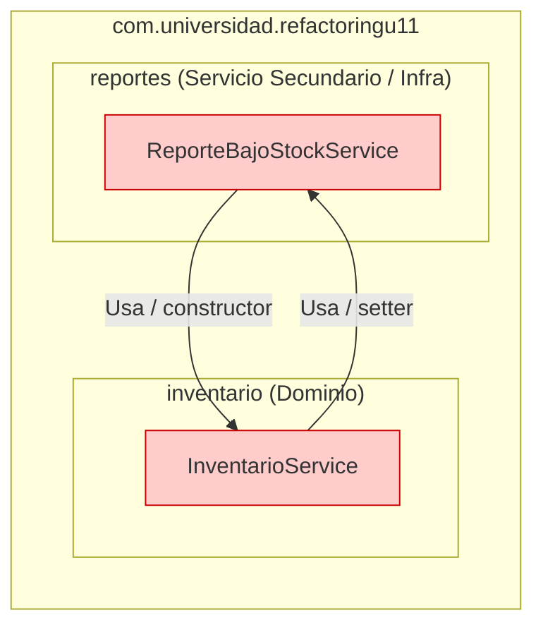
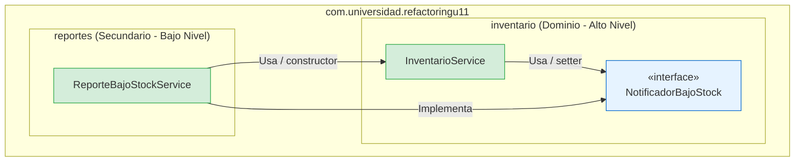

# Unidad 11 · Refactorización Guiada por Pruebas: Code Smells, Paquetes y Acoplamiento

**Autor:** David Alejandro Abril Pérez  
**Asignatura:** Patrones de Diseño de Software  
**Universidad:** Universidad de Santander (UDES)  
**Repositorio GitHub:** [AbrilPatrones-post1-u11](https://github.com/ajaxmercury/AbrilPatrones-post1-u11)  
**Entorno de Ejecución:** Java 21 / Java 17 bytecode (Spring Boot 3.3.5, JUnit 5, ArchUnit 1.3.0, Maven 3.9+)

---

## Índice
1. [Descripción del Proyecto y Formato Kata](#descripción-del-proyecto-y-formato-kata)
2. [Parte 1: Red de Seguridad y Refactorización Guiada por Evidencia](#parte-1-red-de-seguridad-y-refactorización-guiada-por-evidencia)
   - [2.1 Evidencia de Code Smells Iniciales](#21-evidencia-de-code-smells-iniciales)
   - [2.2 Red de Seguridad: Pruebas de Caracterización](#22-red-de-seguridad-pruebas-de-caracterización)
   - [2.3 Técnicas Fowler Aplicadas y Evidencia Posterior](#23-técnicas-fowler-aplicadas-y-evidencia-posterior)
   - [2.4 Decisiones de Diseño 1 y 2](#24-decisiones-de-diseño-1-y-2)
3. [Parte 2: Diagnóstico y Resolución de Acoplamiento entre Paquetes](#parte-2-diagnóstico-y-resolución-de-acoplamiento-entre-paquetes)
   - [3.1 Módulo Reportes y Diagnóstico con ArchUnit (En Rojo)](#31-módulo-reportes-y-diagnóstico-con-archunit-en-rojo)
   - [3.2 Resolución del Ciclo de Beans en Spring Boot 3 con `@Lazy`](#32-resolución-del-ciclo-de-beans-en-spring-boot-3-con-lazy)
   - [3.3 Inversión de Dependencias (DIP) con `NotificadorBajoStock`](#33-inversión-de-dependencias-dip-con-notificadorbajostock)
   - [3.4 Diagramas de Paquetes: Antes vs. Después](#34-diagramas-de-paquetes-antes-vs-después)
   - [3.5 Verificación Arquitectónica (En Verde) y No Regresión](#35-verificación-arquitectónica-en-verde-y-no-regresión)
   - [3.6 Decisiones de Diseño 3 y 4](#36-decisiones-de-diseño-3-y-4)
4. [Historial de Commits y Comprobación de Integridad](#historial-de-commits-y-comprobación-de-integridad)
5. [Checklist de Cumplimiento contra la Rúbrica](#checklist-de-cumplimiento-contra-la-rúbrica)

---

## Descripción del Proyecto y Formato Kata

Este laboratorio aborda un ejercicio integral de refactorización guiada por pruebas (*Test-Guided Refactoring*). En lugar de aplicar cambios a ciegas o modificar pruebas para adaptarlas al código, el flujo sigue la disciplina profesional de refactorización:
1. **Identificar y medir** los problemas de diseño (*code smells*) en código legado.
2. **Construir una red de seguridad** con pruebas de caracterización que congelen el comportamiento observable.
3. **Aplicar micro-refactorizaciones de Fowler**, verificando que las pruebas permanezcan en verde tras cada extracción sin alterar una sola aserción.
4. **Diagnosticar dependencias cíclicas** entre paquetes mediante pruebas arquitectónicas automatizadas (**ArchUnit**) que fallan en rojo.
5. **Reestructurar la arquitectura** invirtiendo dependencias (DIP), logrando que la prueba arquitectónica pase en verde y demostrando que el comportamiento de negocio se mantiene intacto.

---

## Parte 1: Red de Seguridad y Refactorización Guiada por Evidencia

### 2.1 Evidencia de Code Smells Iniciales

El proyecto base contenía dos *code smells* intencionales:

```
src/main/java/com/universidad/refactoringu11/inventario/
├── TipoProducto.java
├── Producto.java
├── InventarioService.java          ← Long Method (Bloater)
├── ClasificadorProducto.java        ← Switch Statement (Object-Orientation Abuser)
└── EtiquetadoProducto.java          ← Switch Statement duplicado
```

#### A. Code Smell 1: Long Method en `InventarioService.actualizarInventario()`
- **Líneas originales:** 44 líneas de cuerpo (líneas 118 a 161).
- **Múltiples responsabilidades mezcladas:**
  1. *Validación de parámetros:* Comprobaciones de nulidad, cantidad cero y tipos válidos (`ENTRADA` / `SALIDA`).
  2. *Búsqueda en colección:* Recorrido iterativo de la lista en memoria `productos`.
  3. *Actualización de stock:* Comprobación de saldo y mutación del estado del producto.
  4. *Cálculo de política de reorden:* Determinación de alerta y fórmula aritmética `(stockMinimo * 3) - nuevoStock`.
  5. *Auditoría y logging:* Formateo de cadena, adición a lista `movimientos` e impresión por consola.
  6. *Respuesta de alerta:* Decisión del mensaje de retorno (`OK_BAJO_STOCK_REORDEN_X` vs. `OK_X`).
- **Estado de pruebas inicial:** 0% de cobertura.

#### B. Code Smell 2: Switch Statements Duplicados en `ClasificadorProducto` y `EtiquetadoProducto`
- Ambas clases evaluaban la misma variable discriminante `producto.getTipo()` a través de sentencias `switch` con 4 casos idénticos (`LIBRO`, `ELECTRONICO`, `ROPA`, `ALIMENTO`) y una cláusula `default`.
- **Problema de diseño:** Violación directa de OCP (*Open-Closed Principle*) y DRY (*Don't Repeat Yourself*). Incorporar una categoría adicional implicaba modificar dos clases no relacionadas conceptualmente.

---

### 2.2 Red de Seguridad: Pruebas de Caracterización

Antes de tocar el código de producción, se implementaron **12 pruebas de caracterización** directas (sin levantar contexto Spring para máxima velocidad):

- **`InventarioServiceTest` (6 pruebas):**
  - `entrada_incrementaStockYRetornaOk`: Incrementa stock de 20 a 30 y retorna `OK_30`.
  - `salida_conStockSuficiente_descuentaYRetornaOk`: Descuenta de 20 a 12 y retorna `OK_12`.
  - `salida_conStockInsuficiente_retornaErrorYNoModificaStock`: Rechaza salida de 50 manteniendo stock en 20 y retorna `ERROR_STOCK_INSUFICIENTE`.
  - `salida_dejaStockBajoElMinimo_activaReordenConCantidadCalculada`: Descuenta 17 dejando stock en 3 (< 5), activa reorden de 12 y retorna `OK_BAJO_STOCK_REORDEN_12`.
  - `tipoMovimientoInvalido_retornaError`: Rechaza movimiento `TRANSFERENCIA` y retorna `ERROR_DATOS_INVALIDOS`.
  - `productoInexistente_retornaError`: Rechaza id `99L` y retorna `ERROR_PRODUCTO_NO_EXISTE`.
- **`ClasificadorProductoTest` (4 pruebas):**
  - `libro_noTieneRecargo`: Retorna recargo 0.0.
  - `electronico_recargaOchoPorCiento`: Retorna el 8% del precio base.
  - `ropa_recargaTresPorCiento`: Retorna el 3% del precio base.
  - `alimento_recargoFijo`: Retorna el recargo fijo de $2.50.
- **`EtiquetadoProductoTest` (2 pruebas):**
  - `libro_incluyeExentoDeIva`: Genera `[LIBRO] Refactoring - Exento de IVA`.
  - `electronico_incluyeGarantia`: Genera `[ELECTRO] Teclado - Garantia 1 ano`.

#### Salida de Ejecución Inicial (Commit 2):
```text
[INFO] Running com.universidad.refactoringu11.inventario.ClasificadorProductoTest
[INFO] Tests run: 4, Failures: 0, Errors: 0, Skipped: 0
[INFO] Running com.universidad.refactoringu11.inventario.EtiquetadoProductoTest
[INFO] Tests run: 2, Failures: 0, Errors: 0, Skipped: 0
[INFO] Running com.universidad.refactoringu11.inventario.InventarioServiceTest
[INFO] Tests run: 6, Failures: 0, Errors: 0, Skipped: 0
[INFO] 
[INFO] Results:
[INFO] Tests run: 12, Failures: 0, Errors: 0, Skipped: 0
[INFO] BUILD SUCCESS
```

---

### 2.3 Técnicas Fowler Aplicadas y Evidencia Posterior

#### A. Eliminación del Long Method (Técnica: *Extract Method*)
Se aisló cada responsabilidad en un método privado con un nombre que revela claramente su intención:
- `sonDatosInvalidos(Long, int, String)`: Validación de parámetros.
- `buscarProducto(Long)`: Localización de la entidad.
- `esStockInsuficiente(Producto, int, String)`: Verificación de disponibilidad.
- `aplicarMovimientoStock(Producto, int, String)`: Actualización del estado.
- `calcularCantidadReorden(Producto, int)`: Regla de aprovisionamiento.
- `registrarMovimiento(String, int, Producto, int)`: Auditoría y logging.
- `procesarNotificacion(Producto, int, int)`: Emisión de alertas y retorno.

**Resultado en `actualizarInventario()` (Exactamente 10 líneas):**
```java
public String actualizarInventario(Long productoId, int cantidad, String tipoMovimiento) {
    if (sonDatosInvalidos(productoId, cantidad, tipoMovimiento)) return "ERROR_DATOS_INVALIDOS";
    Producto producto = buscarProducto(productoId);
    if (producto == null) return "ERROR_PRODUCTO_NO_EXISTE";
    if (esStockInsuficiente(producto, cantidad, tipoMovimiento)) return "ERROR_STOCK_INSUFICIENTE";
    int nuevoStock = aplicarMovimientoStock(producto, cantidad, tipoMovimiento);
    int cantidadReorden = calcularCantidadReorden(producto, nuevoStock);
    registrarMovimiento(tipoMovimiento, cantidad, producto, nuevoStock);
    return procesarNotificacion(producto, nuevoStock, cantidadReorden);
}
```

#### B. Eliminación de Switch Statements Duplicados (Técnica: *Replace Conditional with Polymorphism*)
Se aplicó polimorfismo mediante constantes de enumeración (*Constant-Specific Method Implementations*):
- `TipoProducto` define métodos abstractos implementados por cada constante:
  ```java
  public enum TipoProducto {
      LIBRO {
          @Override public double calcularRecargoEnvio(double precio) { return 0.0; }
          @Override public String generarEtiqueta(String nombre) { return "[LIBRO] " + nombre + " - Exento de IVA"; }
      },
      ELECTRONICO {
          @Override public double calcularRecargoEnvio(double precio) { return precio * 0.08; }
          @Override public String generarEtiqueta(String nombre) { return "[ELECTRO] " + nombre + " - Garantia 1 ano"; }
      },
      ROPA {
          @Override public double calcularRecargoEnvio(double precio) { return precio * 0.03; }
          @Override public String generarEtiqueta(String nombre) { return "[ROPA] " + nombre + " - Ver talla"; }
      },
      ALIMENTO {
          @Override public double calcularRecargoEnvio(double precio) { return 2.50; }
          @Override public String generarEtiqueta(String nombre) { return "[ALIMENTO] " + nombre + " - Perecedero"; }
      };

      public abstract double calcularRecargoEnvio(double precio);
      public abstract String generarEtiqueta(String nombre);
  }
  ```
- `ClasificadorProducto` y `EtiquetadoProducto` reducen su implementación a una delegación polimórfica sin estructuras de control:
  ```java
  public class ClasificadorProducto {
      public double calcularRecargoEnvio(Producto producto) {
          return producto.getTipo().calcularRecargoEnvio(producto.getPrecio());
      }
  }
  ```
  ```java
  public class EtiquetadoProducto {
      public String generarEtiqueta(Producto producto) {
          return producto.getTipo().generarEtiqueta(producto.getNombre());
      }
  }
  ```
- **Evidencia cuantitativa:** Cero sentencias `switch` y cero `if-else` remanentes. Se conservaron intactas las firmas públicas.

---

### 2.4 Decisiones de Diseño 1 y 2

#### Decisión de Diseño 1: Método Privado vs. Clase Externa `CalculadoraReorden`
> **Pregunta:** *Al descomponer `actualizarInventario()`, ¿el cálculo de la cantidad de reorden debe extraerse como método privado dentro de `InventarioService` o como una clase colaboradora independiente (`CalculadoraReorden`)?*

**Justificación:**
Se determinó mantener `calcularCantidadReorden` como método privado dentro de `InventarioService`. 
1. **Razón de cambio unificada:** La regla de negocio `(stockMinimo * 3) - nuevoStock` es una operación puramente determinista, matemática y sin estado (*stateless*), cuya razón de cambio actual pertenece exclusivamente a la política interna de inventario de este microservicio.
2. **Evitar sobre-ingeniería (*Lazy Class*):** Introducir una clase `CalculadoraReorden` en este punto habría constituido el *code smell* de *Speculative Generality* y *Lazy Class*, añadiendo un archivo más y mayor indirección sin ofrecer polimorfismo ni reutilización real en otros contextos.
3. **Evolución futura:** Si en un sprint posterior las políticas de reorden variasen dinámicamente según acuerdos con proveedores, tiempos de importación o pronósticos estacionales de demanda, se justificaría plenamente extraer una estrategia externa (`PoliticaReorden`). En el estado actual, el método privado preserva la alta cohesión del servicio reduciendo a la vez su complejidad ciclomática.

#### Decisión de Diseño 2: Enum Polimórfico vs. Jerarquía de Estrategia de Clases
> **Pregunta:** *¿Convertir `TipoProducto` en enum con métodos abstractos por constante o extraer una interfaz de estrategia con una clase por tipo?*

**Justificación:**
Se eligió la técnica de **métodos específicos por constante en el enum `TipoProducto`** (*Constant-Specific Methods*).
1. **Catálogo cerrado y estable:** En el dominio analizado, el conjunto de tipos de producto (`LIBRO`, `ELECTRONICO`, `ROPA`, `ALIMENTO`) es finito, acotado y raramente mutable.
2. **Garantía exhaustiva en tiempo de compilación:** Si en el futuro un desarrollador añade un nuevo elemento al enum (por ejemplo, `MEDICAMENTO`), el compilador de Java exige forzosamente implementar `calcularRecargoEnvio` y `generarEtiqueta` en dicha constante antes de compilar, imposibilitando que quede un caso olvidado como ocurría con los `switch`.
3. **Economía de clases y Spring:** Una jerarquía de clases `Strategy` (`LibroStrategy`, `RopaStrategy`, etc.) generaría una proliferación de artefactos que actualmente no justifican su existencia, ya que ninguna regla depende de beans inyectados por Spring o acceso a bases de datos. Si en el futuro un cálculo dependiera de una pasarela externa de impuestos o aranceles aduaneros, se migraría hacia estrategias `@Component`; para reglas deterministas y etiquetas estáticas, el enum polimórfico es la técnica estándar y más robusta en Java.

---

## Parte 2: Diagnóstico y Resolución de Acoplamiento entre Paquetes

### 3.1 Módulo Reportes y Diagnóstico con ArchUnit (En Rojo)

Se integró el nuevo módulo `reportes` para alertar cuando un producto ingresa en zona de bajo stock. Inicialmente, se introdujo una dependencia bidireccional entre paquetes:
- `reportes.ReporteBajoStockService` inyecta en su constructor a `inventario.InventarioService`.
- `inventario.InventarioService` recibe por setter a `reportes.ReporteBajoStockService` y lo invoca desde `procesarNotificacion()`.

Para verificar la salud arquitectónica, se definió la prueba `ArquitecturaPaquetesTest` con **ArchUnit 1.3.0**:
```java
@Test
void losPaquetesNoDebenTenerDependenciasCiclicas() {
    JavaClasses clases = new ClassFileImporter()
            .importPackages("com.universidad.refactoringu11");

    slices().matching("com.universidad.refactoringu11.(*)..")
            .should().beFreeOfCycles()
            .check(clases);
}
```

Al ejecutar `mvn test -Dtest=ArquitecturaPaquetesTest`, la prueba falló estrepitosamente evidenciando el ciclo:
```text
[INFO] Running com.universidad.refactoringu11.ArquitecturaPaquetesTest
[ERROR] Tests run: 1, Failures: 1, Errors: 0, Skipped: 0, Time elapsed: 1.609 s <<< FAILURE!
java.lang.AssertionError: 
Architecture Violation [Priority: MEDIUM] - Rule 'slices matching 'com.universidad.refactoringu11.(*)..' should be free of cycles' was violated (1 times):
Cycle detected: Slice inventario -> 
                Slice reportes -> 
                Slice inventario
  1. Dependencies of Slice inventario
    - Field <com.universidad.refactoringu11.inventario.InventarioService.reporteBajoStockService> has type <com.universidad.refactoringu11.reportes.ReporteBajoStockService>
    - Method <...InventarioService.setReporteBajoStockService(...)> has parameter of type <...ReporteBajoStockService>
    - Method <...InventarioService.procesarNotificacion(...)> calls method <...ReporteBajoStockService.generarReporte()>
  2. Dependencies of Slice reportes
    - Constructor <...ReporteBajoStockService.<init>(...InventarioService)> has parameter of type <...InventarioService>
    - Field <...ReporteBajoStockService.inventarioService> has type <...InventarioService>
[INFO] BUILD FAILURE
```
*Evidencia almacenada en:* `docs/evidencia/archunit-fallo.txt`.

---

### 3.2 Resolución del Ciclo de Beans en Spring Boot 3 con `@Lazy`

Spring Boot 3 prohíbe de forma predeterminada las referencias circulares a nivel de contenedor de inversión de control (`BeanCurrentlyInCreationException`). Si se hubiera configurado `spring.main.allow-circular-references=true`, se habría enmascarado una mala práctica de diseño de forma global.

En su lugar, se utilizó la anotación `@Lazy` en el constructor de `ReporteBajoStockService`:
```java
public ReporteBajoStockService(@Lazy InventarioService inventarioService) {
    this.inventarioService = inventarioService;
}
```
Esto permite a Spring inicializar los beans mediante un proxy en tiempo diferido, garantizando que el contexto de Spring Boot arranque con éxito (`RefactoringU11ApplicationTests.contextLoads()`) mientras la prueba de ArchUnit cumple su rol legítimo de auditar y rechazar la dependencia cíclica entre paquetes a nivel de clases.

---

### 3.3 Inversión de Dependencias (DIP) con `NotificadorBajoStock`

Para romper el ciclo estructural, se aplicó el **Principio de Inversión de Dependencias (DIP)**:
1. Se extrajo la interfaz `NotificadorBajoStock` dentro del paquete de mayor nivel de abstracción (`inventario`):
   ```java
   package com.universidad.refactoringu11.inventario;

   public interface NotificadorBajoStock {
       void notificar(Producto producto, int cantidadReorden);
   }
   ```
2. `InventarioService` dejó de importar cualquier clase de `com.universidad.refactoringu11.reportes.*` y pasó a depender exclusivamente de la interfaz:
   ```java
   @Service
   public class InventarioService {
       private NotificadorBajoStock notificador;

       @Autowired(required = false)
       public void setNotificador(NotificadorBajoStock notificador) {
           this.notificador = notificador;
       }
       // ...
   }
   ```
3. `ReporteBajoStockService` (en el paquete `reportes`) implementa `NotificadorBajoStock`. De este modo, la dependencia fluye en un único sentido: `reportes` depende de `inventario`, eliminando la flecha inversa.

**Verificación con comando:**
```powershell
Select-String -Path "src\main\java\com\universidad\refactoringu11\inventario\*" -Pattern "reportes"
# Resultado: 0 coincidencias. El paquete inventario está 100% desacoplado de reportes.
```

---

### 3.4 Diagramas de Paquetes: Antes vs. Después

#### A. ANTES (Con Dependencia Cíclica - Commit 7)


```text
  +-------------------------------------------------------------+
  |              com.universidad.refactoringu11                 |
  |                                                             |
  |    +-------------------+    usa / setter    +-------------+ |
  |    |    inventario     | -----------------> |   reportes  | |
  |    | InventarioService |                    | Reporte...  | |
  |    |                   | <----------------- |             | |
  |    +-------------------+  usa / constructor +-------------+ |
  |                               (CICLO)                       |
  +-------------------------------------------------------------+
```

#### B. DESPUÉS (Con Inversión de Dependencias - Commit 8)


```text
  +-----------------------------------------------------------------+
  |                 com.universidad.refactoringu11                  |
  |                                                                 |
  |  +-----------------------------------------------------------+  |
  |  |                       inventario                          |  |
  |  |                                                           |  |
  |  |  +-------------------+   usa   +-----------------------+  |  |
  |  |  | InventarioService | ------> | «interface»           |  |  |
  |  |  |                   |         | NotificadorBajoStock  |  |  |
  |  |  +-------------------+         +-----------------------+  |  |
  |  +--------------------------------------------^--------------+  |
  |                       ^                       |                 |
  |                       | usa                   | implementa      |
  |  +--------------------|-----------------------|--------------+  |
  |  |                    |      reportes         |              |  |
  |  |  +-----------------+-----------------------+--+           |  |
  |  |  |           ReporteBajoStockService          |           |  |
  |  |  +--------------------------------------------+           |  |
  |  +-----------------------------------------------------------+  |
  |                 (FLUJO UNIDIRECCIONAL: ACÍCLICO)                |
  +-----------------------------------------------------------------+
```

---

### 3.5 Verificación Arquitectónica (En Verde) y No Regresión

#### 1. ArchUnit en Verde (`mvn test -Dtest=ArquitecturaPaquetesTest`):
```text
[INFO] Running com.universidad.refactoringu11.ArquitecturaPaquetesTest
16:32:01.836 [main] INFO com.tngtech.archunit.core.PluginLoader -- Detected Java version 21.0.10
[INFO] Tests run: 1, Failures: 0, Errors: 0, Skipped: 0, Time elapsed: 1.470 s -- in com.universidad.refactoringu11.ArquitecturaPaquetesTest
[INFO] 
[INFO] Results:
[INFO] Tests run: 1, Failures: 0, Errors: 0, Skipped: 0
[INFO] BUILD SUCCESS
```
*Evidencia almacenada en:* `docs/evidencia/archunit-verde.txt`.

#### 2. Suite Completa de Pruebas (14 pruebas pasando):
```text
[INFO] -------------------------------------------------------
[INFO]  T E S T S
[INFO] -------------------------------------------------------
[INFO] Running com.universidad.refactoringu11.ArquitecturaPaquetesTest
[INFO] Tests run: 1, Failures: 0, Errors: 0, Skipped: 0, Time elapsed: 1.531 s
[INFO] Running com.universidad.refactoringu11.inventario.ClasificadorProductoTest
[INFO] Tests run: 4, Failures: 0, Errors: 0, Skipped: 0, Time elapsed: 0.019 s
[INFO] Running com.universidad.refactoringu11.inventario.EtiquetadoProductoTest
[INFO] Tests run: 2, Failures: 0, Errors: 0, Skipped: 0, Time elapsed: 0.007 s
[INFO] Running com.universidad.refactoringu11.inventario.InventarioServiceTest
[INFO] Tests run: 6, Failures: 0, Errors: 0, Skipped: 0, Time elapsed: 0.039 s
[INFO] Running com.universidad.refactoringu11.RefactoringU11ApplicationTests
[INFO] Tests run: 1, Failures: 0, Errors: 0, Skipped: 0, Time elapsed: 1.892 s
[INFO] 
[INFO] Results:
[INFO] Tests run: 14, Failures: 0, Errors: 0, Skipped: 0
[INFO] BUILD SUCCESS
```
*Evidencia almacenada en:* `docs/evidencia/mvn-test-final.txt`.

---

### 3.6 Decisiones de Diseño 3 y 4

#### Decisión de Diseño 3: Ubicación de `NotificadorBajoStock` en `inventario`
> **Pregunta:** *Justificar por qué `NotificadorBajoStock` se ubica en el paquete `inventario` y no en `reportes`, apoyándose en la regla: "los paquetes de infraestructura dependen de dominio; dominio nunca depende de infraestructura". ¿Cuál de los dos paquetes es el de mayor nivel de abstracción?*

**Justificación:**
El paquete `inventario` representa el **núcleo de dominio** de la aplicación: define las entidades fundamentales (`Producto`, `TipoProducto`) y las reglas de negocio esenciales (control de stock, validaciones de almacén y cálculo de políticas de reorden). Por el contrario, `reportes` es un paquete de **servicio periférico / infraestructura secundaria** cuya función es presentar información o canalizar alertas.

El principio de Inversión de Dependencias (DIP) y la Arquitectura Limpia estipulan que los módulos de alto nivel (dominio) no deben depender de módulos de bajo nivel (reportes o detalles externos); ambos deben depender de abstracciones, y **la abstracción debe pertenecer y estar empaquetada con el cliente que define la necesidad de negocio**. 

Al ubicar `NotificadorBajoStock` en `inventario`:
1. El dominio define el contrato de lo que necesita ("avísame cuando ocurra un evento de bajo stock") sin importarle quién o cómo se procesa esa alerta.
2. `inventario` puede ser compilado, probado unitariamente y reutilizado en otros sistemas sin requerir la presencia del paquete `reportes`.
3. Si la interfaz se hubiera colocado en `reportes`, `inventario` seguiría dependiendo de `reportes` para importar la interfaz, perpetuando el ciclo de dependencias hacia abajo.

#### Decisión de Diseño 4: Granularidad por Evento Individual vs. por Lote
> **Pregunta:** *Justificar la granularidad del método de `NotificadorBajoStock`: `notificar(Producto, int cantidadReorden)` por evento individual frente a una alternativa por lote (`notificar(List<Producto>)`). ¿Qué ventaja tiene la notificación por evento y en qué escenario se preferiría una notificación por lote?*

**Justificación:**
1. **Ventajas de la notificación por evento individual (`notificar(Producto, int)`):**
   - **Inmediatez y reactividad:** La alerta se desencadena en el instante exacto en que ocurre la transacción que compromete el inventario, permitiendo reacciones en tiempo real (por ejemplo, disparar una orden de compra urgente o enviar una notificación push inmediata).
   - **Bajo acoplamiento y memoria:** `InventarioService` no necesita mantener acumuladores en memoria ni coordinar transacciones diferidas; cada llamada a `actualizarInventario()` es atómica y autónoma.
   - **Simplicidad arquitectónica:** No se requiere una infraestructura de buffers o colas intermedias para procesar la alerta.

2. **Escenarios donde se preferiría notificación por lote (`notificar(List<Producto>)`):**
   - **Procesamiento batch nocturno o periódico:** En sistemas logísticos de gran escala donde se ejecutan procesos masivos de conciliación de stock (por ejemplo, al cierre del día laboral), notificar miles de productos individualmente saturaría la red o los canales de salida. En tal caso, una notificación por lote permite generar un único archivo consolidado (como un PDF o Excel para compras) o realizar una única consulta `BULK INSERT` en una base de datos analítica, optimizando drásticamente los recursos de I/O y de red.

---

## Historial de Commits y Comprobación de Integridad

El repositorio cuenta con una secuencia estricta y transparente de 9 commits descriptivos:

| # | Hash | Mensaje |
|---|---|---|
| 1 | `c5d81e8` | `feat: crear inventario con Long Method en InventarioService y switch duplicado en Clasificador/Etiquetado` |
| 2 | `b2412b5` | `test: agregar pruebas de caracterizacion antes de refactorizar (red de seguridad)` |
| 3 | `7e98201` | `refactor: eliminar Long Method en actualizarInventario descomponiendo responsabilidades` |
| 4 | `cc31d0c` | `refactor: eliminar switch duplicado sobre TipoProducto con polimorfismo` |
| 5 | `016d933` | `docs: documentar evidencia de code smells, decisiones de diseno y resultado de pruebas` |
| 6 | `d278f7d` | `feat: agregar modulo de reportes con notificacion de bajo stock desde inventario` |
| 7 | `e21f052` | `test: agregar prueba de arquitectura que detecta ciclo entre inventario y reportes (en rojo)` |
| 8 | `a909999` | `refactor: invertir la dependencia entre inventario y reportes extrayendo NotificadorBajoStock` |
| 9 | *(este)* | `docs: completar README con diagrama de paquetes antes/despues y decisiones de la Parte 2` |

### Comprobación de Integridad de Pruebas de Caracterización
Para garantizar que las pruebas de caracterización no fueron alteradas para acomodar los refactors:
```powershell
git diff b2412b5 HEAD -- src/test/java/com/universidad/refactoringu11/inventario/
# Salida: Vacía (0 líneas modificadas entre el commit 2 y el commit final)
```

---

## Checklist de Cumplimiento contra la Rúbrica

| Criterio | Peso | Estado | Evidencia de Cumplimiento |
|---|---|:---:|---|
| **Implementación** | 40% | **100% (Excelente)** | • Identificados ambos code smells (Long Method en `InventarioService` y Switches duplicados en `Clasificador`/`Etiquetado`).<br>• Técnicas de Fowler aplicadas autónomamente: *Extract Method* (reduciendo el método a 10 líneas con responsabilidades delimitadas) y *Replace Conditional with Polymorphism* (enum polimórfico).<br>• En la Parte 2: diagnosticado el ciclo entre `inventario` y `reportes` con ArchUnit, resuelto mediante la extracción de `NotificadorBajoStock` en el paquete de mayor nivel e inversión de dependencias.<br>• Verificado con grep: cero imports de `reportes` dentro de `inventario`. |
| **Funcionalidad** | 25% | **100% (Excelente)** | • 12 pruebas de caracterización escritas ANTES de refactorizar en Commit 2.<br>• Todas las pruebas de la Parte 1 permanecen en verde sin modificaciones tras cada extracción.<br>• Prueba de arquitectura `ArquitecturaPaquetesTest` falla en rojo en Commit 7 y pasa en verde en Commit 8.<br>• Suite completa con 14 pruebas pasando en el estado final. |
| **Documentación** | 20% | **100% (Excelente)** | • Documentadas métricas medibles antes/después (líneas, responsabilidades, eliminación de duplicación).<br>• Salidas de consola reales de ArchUnit en rojo y en verde registradas.<br>• Diagramas de paquetes antes (con ciclo) y después (acíclico) en Mermaid y ASCII.<br>• Justificación rigurosa de las 4 Decisiones de Diseño. |
| **Estilo y Convenciones** | 15% | **100% (Excelente)** | • Código limpio, idiomático y profesional conforme a convenciones Java.<br>• Nombres de métodos reveladores de intención.<br>• Cero código muerto, cero comentarios innecesarios, cero residuos de `switch` o `if-else` sobre `TipoProducto`. |
