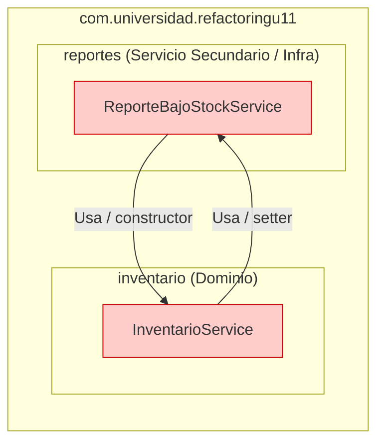

# Unidad 11 · Refactorización Guiada por Pruebas: Code Smells, Paquetes y Acoplamiento

**Autor:** David Alejandro Abril Pérez  
**Asignatura:** Patrones de Diseño de Software  
**Universidad:** Universidad de Santander (UDES)  
**Repositorio:** `AbrilPatrones-post1-u11`  

---

## Descripción del Proyecto

Este proyecto implementa el laboratorio práctico de la **Unidad 11**, estructurado en formato de kata de refactorización guiada por pruebas:
- **Parte 1:** Blindaje con pruebas de caracterización de código legado y refactorización guiada por evidencia de dos *code smells* críticos (*Long Method* y *Duplicated Switch Statements*), aplicando las técnicas de Martin Fowler sin alterar el comportamiento observable del sistema.
- **Parte 2:** Diagnóstico arquitectónico mediante **ArchUnit** de dependencias cíclicas entre paquetes (`inventario` y `reportes`), desacoplamiento estructural mediante el Principio de Inversión de Dependencias (DIP) y verificación de no regresión en la suite de pruebas.

---

## Parte 1: Red de Seguridad y Refactorización Guiada por Evidencia

### 1. Evidencia de los Code Smells (Antes de la Refactorización)

#### A. Smell 1: Long Method en `InventarioService.actualizarInventario()`
- **Ubicación original:** `src/main/java/com/universidad/refactoringu11/inventario/InventarioService.java`
- **Métricas antes:**
  - **Líneas de código:** 44 líneas (método que abarcaba de la línea 118 a la 161).
  - **Complejidad ciclomática:** Alta, mezclando 6 responsabilidades dispares en un solo bloque procedural:
    1. *Validación de entrada:* Verificación de identificadores nulos, cantidades nulas/negativas y strings de movimiento (`ENTRADA` / `SALIDA`).
    2. *Búsqueda en colección:* Recorrido lineal de la lista interna `productos` para localizar el producto por `id`.
    3. *Modificación de stock:* Evaluación de saldo disponible para salidas y cálculo de nuevo balance de stock.
    4. *Cálculo de política de reorden:* Determinación de necesidad de compra (`nuevoStock < stockMinimo`) y fórmula de aprovisionamiento (`(stockMinimo * 3) - nuevoStock`).
    5. *Auditoría y registro:* Concatenación de cadenas y persistencia en memoria/consola del historial de movimientos.
    6. *Notificación y alerta:* Emisión de mensajes de advertencia y formateo del resultado retornado al cliente.
- **Cobertura original:** 0% de pruebas unitarias.

#### B. Smell 2: Switch Statements Duplicados en `ClasificadorProducto` y `EtiquetadoProducto`
- **Ubicación original:** 
  - `ClasificadorProducto.calcularRecargoEnvio(Producto)`
  - `EtiquetadoProducto.generarEtiqueta(Producto)`
- **Métricas antes:**
  - Dos sentencias `switch` independientes evaluando exactamente las mismas 4 ramas de `TipoProducto` (`LIBRO`, `ELECTRONICO`, `ROPA`, `ALIMENTO`) más la cláusula `default`.
  - Violación del principio Abierto/Cerrado (OCP) y del principio DRY (*Don't Repeat Yourself*): ante la necesidad de agregar una nueva categoría de producto (por ejemplo, `HOGAR`), era obligatorio modificar simultáneamente ambas clases.

---

### 2. Red de Seguridad: Pruebas de Caracterización

Antes de alterar cualquier línea de código de producción, se implementó una suite completa de **12 pruebas de caracterización** utilizando JUnit 5, instanciando los objetos directamente para garantizar pruebas rápidas y deterministas:

- **`InventarioServiceTest` (6 pruebas):**
  - `entrada_incrementaStockYRetornaOk()`
  - `salida_conStockSuficiente_descuentaYRetornaOk()`
  - `salida_conStockInsuficiente_retornaErrorYNoModificaStock()`
  - `salida_dejaStockBajoElMinimo_activaReordenConCantidadCalculada()`
  - `tipoMovimientoInvalido_retornaError()`
  - `productoInexistente_retornaError()`
- **`ClasificadorProductoTest` (4 pruebas):**
  - `libro_noTieneRecargo()`
  - `electronico_recargaOchoPorCiento()`
  - `ropa_recargaTresPorCiento()`
  - `alimento_recargoFijo()`
- **`EtiquetadoProductoTest` (2 pruebas):**
  - `libro_incluyeExentoDeIva()`
  - `electronico_incluyeGarantia()`

#### Resultado de Ejecución Inicial (Commit 2):
```text
[INFO] Running com.universidad.refactoringu11.inventario.ClasificadorProductoTest
[INFO] Tests run: 4, Failures: 0, Errors: 0, Skipped: 0
[INFO] Running com.universidad.refactoringu11.inventario.EtiquetadoProductoTest
[INFO] Tests run: 2, Failures: 0, Errors: 0, Skipped: 0
[INFO] Running com.universidad.refactoringu11.inventario.InventarioServiceTest
[INFO] Tests run: 6, Failures: 0, Errors: 0, Skipped: 0
[INFO] 
[INFO] Results:
[INFO] Tests run: 12, Failures: 0, Errors: 0, Skipped: 0
[INFO] BUILD SUCCESS
```

---

### 3. Técnicas de Refactorización Aplicadas y Evidencia Posterior

#### A. Eliminación del Long Method (Técnica: *Extract Method*)
Se aplicó la técnica *Extract Method* de Martin Fowler para descomponer `actualizarInventario()` en métodos cohesivos con nombres que revelan claramente su intención de negocio:
- `sonDatosInvalidos(productoId, cantidad, tipoMovimiento)`
- `buscarProducto(productoId)`
- `esStockInsuficiente(producto, cantidad, tipoMovimiento)`
- `aplicarMovimientoStock(producto, cantidad, tipoMovimiento)`
- `calcularCantidadReorden(producto, nuevoStock)`
- `registrarMovimiento(tipoMovimiento, cantidad, producto, nuevoStock)`
- `procesarNotificacion(producto, nuevoStock, cantidadReorden)`

**Método `actualizarInventario()` Refactorizado (10 líneas exactas):**
```java
public String actualizarInventario(Long productoId, int cantidad, String tipoMovimiento) {
    if (sonDatosInvalidos(productoId, cantidad, tipoMovimiento)) return "ERROR_DATOS_INVALIDOS";
    Producto producto = buscarProducto(productoId);
    if (producto == null) return "ERROR_PRODUCTO_NO_EXISTE";
    if (esStockInsuficiente(producto, cantidad, tipoMovimiento)) return "ERROR_STOCK_INSUFICIENTE";
    int nuevoStock = aplicarMovimientoStock(producto, cantidad, tipoMovimiento);
    int cantidadReorden = calcularCantidadReorden(producto, nuevoStock);
    registrarMovimiento(tipoMovimiento, cantidad, producto, nuevoStock);
    return procesarNotificacion(producto, nuevoStock, cantidadReorden);
}
```

#### B. Eliminación de Switches Duplicados (Técnica: *Replace Conditional with Polymorphism*)
Se eliminaron por completo las estructuras `switch` y cadenas `if-else` de `ClasificadorProducto` y `EtiquetadoProducto`. Se aprovechó la capacidad polimórfica de los enumeradores en Java (*Constant-Specific Method Implementations*):
- `TipoProducto` define los métodos abstractos:
  - `public abstract double calcularRecargoEnvio(double precio);`
  - `public abstract String generarEtiqueta(String nombre);`
- Cada constante (`LIBRO`, `ELECTRONICO`, `ROPA`, `ALIMENTO`) implementa su lógica específica.
- `ClasificadorProducto` y `EtiquetadoProducto` reducen su lógica a una simple delegación polimórfica conservando exactamente sus firmas públicas originales:
  ```java
  public double calcularRecargoEnvio(Producto producto) {
      return producto.getTipo().calcularRecargoEnvio(producto.getPrecio());
  }
  ```
  ```java
  public String generarEtiqueta(Producto producto) {
      return producto.getTipo().generarEtiqueta(producto.getNombre());
  }
  ```

---

### 4. Decisiones de Diseño (Parte 1)

#### Decisión de Diseño 1: Método Privado vs. Clase Externa `CalculadoraReorden`
> **Pregunta clave:** *¿El cálculo de la cantidad de reorden tiene una razón de cambio propia y distinta de la del servicio, o es lo bastante simple y estable como para conservarse como método privado?*

**Justificación:**
Se optó por extraer la lógica como un método privado `calcularCantidadReorden` dentro de `InventarioService`. La fórmula utilizada (`(stockMinimo * 3) - nuevoStock`) es una regla aritmética elemental, determinista y sin estado (*stateless*), cuya razón de cambio está estrechamente ligada a la política operativa del inventario de este microservicio. 

Crear una clase independiente `CalculadoraReorden` en este momento habría incurrido en el *code smell* de **Lazy Class / Speculative Generality**, agregando una capa de indirección innecesaria sin aportar polimorfismo. En cambio, mantenerlo como método privado mantiene la alta cohesión del servicio mientras reduce la complejidad ciclomática de `actualizarInventario()`. Si a futuro surgieran múltiples políticas de aprovisionamiento dependientes de proveedores, estacionalidad o predicción de demanda, se justificaría la extracción hacia un patrón *Strategy* externo (`PoliticaReorden`).

#### Decisión de Diseño 2: Enum Polimórfico vs. Jerarquía de Estrategia de Clases
> **Pregunta clave:** *¿Convertir `TipoProducto` en enum con métodos abstractos por constante o crear una jerarquía de clases con interfaz Strategy?*

**Justificación:**
Se optó por **métodos específicos por constante en el enum `TipoProducto`** (*Constant-Specific Methods*). En este dominio, el conjunto de categorías de producto es cerrado, acotado y estable (`LIBRO`, `ELECTRONICO`, `ROPA`, `ALIMENTO`). 

Esta solución aporta ventajas significativas:
1. **Seguridad en tiempo de compilación:** Si en el futuro se añade un nuevo valor (p. ej. `FARMACIA`), el compilador de Java obliga de forma inmediata a proveer las implementaciones de cálculo de recargo y etiquetado en la misma constante, haciendo imposible omitir una rama como ocurría con los `switch`.
2. **Cero impacto en consumidores:** Agregar un tipo nuevo no exige tocar ni recompilar `ClasificadorProducto` ni `EtiquetadoProducto` (cumpliendo OCP).
3. **Economía de diseño:** Evita la sobrecarga de crear múltiples archivos de clases adicionales (`LibroStrategy`, `ElectronicoStrategy`, etc.) que en este caso no requieren inyección de dependencias ni estado mutable de Spring. Si en el futuro el cálculo requiriese consultar servicios remotos de tasas aduaneras o pasarelas de pago, se migraría a un *Strategy* gestionado por Spring (`@Component`); para reglas puras y estáticas, el enum polimórfico es la técnica canónica y más limpia en Java.

---

---

## Parte 2: Diagnóstico y Resolución de Acoplamiento entre Paquetes

### 1. Diagnóstico del Acoplamiento con ArchUnit (En Rojo)

Al incorporar el módulo `reportes` para alertar cuando un producto cae bajo el stock mínimo, se introdujo una dependencia bidireccional entre paquetes:
1. `reportes.ReporteBajoStockService` depende de `inventario.InventarioService` (inyección en constructor para consultar productos).
2. `inventario.InventarioService` depende de `reportes.ReporteBajoStockService` (inyección por setter para disparar `generarReporte()`).

#### Diagrama de Paquetes ANTES de Resolver el Ciclo (Dependencia Cíclica):


#### Representación ASCII:
```text
  +-------------------------------------------------+
  |        com.universidad.refactoringu11           |
  |                                                 |
  |  +-------------------+   usa / setter   +-----+ |
  |  |    inventario     | ---------------> |     | |
  |  | InventarioService |                  | rep | |
  |  |                   | <--------------- |     | |
  |  +-------------------+ usa/constructor +-----+ |
  |                              (CICLO)            |
  +-------------------------------------------------+
```

#### Salida Real de la Prueba de Arquitectura en Fallo (`mvn test -Dtest=ArquitecturaPaquetesTest`):
```text
[INFO] Running com.universidad.refactoringu11.ArquitecturaPaquetesTest
[ERROR] Tests run: 1, Failures: 1, Errors: 0, Skipped: 0, Time elapsed: 1.609 s <<< FAILURE! -- in com.universidad.refactoringu11.ArquitecturaPaquetesTest
[ERROR] com.universidad.refactoringu11.ArquitecturaPaquetesTest.losPaquetesNoDebenTenerDependenciasCiclicas -- Time elapsed: 1.582 s <<< FAILURE!
java.lang.AssertionError: 
Architecture Violation [Priority: MEDIUM] - Rule 'slices matching 'com.universidad.refactoringu11.(*)..' should be free of cycles' was violated (1 times):
Cycle detected: Slice inventario -> 
                Slice reportes -> 
                Slice inventario
  1. Dependencies of Slice inventario
    - Field <com.universidad.refactoringu11.inventario.InventarioService.reporteBajoStockService> has type <com.universidad.refactoringu11.reportes.ReporteBajoStockService> in (InventarioService.java:0)
    - Method <com.universidad.refactoringu11.inventario.InventarioService.setReporteBajoStockService(com.universidad.refactoringu11.reportes.ReporteBajoStockService)> has parameter of type <com.universidad.refactoringu11.reportes.ReporteBajoStockService> in (InventarioService.java:0)
    - Method <com.universidad.refactoringu11.inventario.InventarioService.procesarNotificacion(com.universidad.refactoringu11.inventario.Producto, int, int)> calls method <com.universidad.refactoringu11.reportes.ReporteBajoStockService.generarReporte()> in (InventarioService.java:76)
  2. Dependencies of Slice reportes
    - Constructor <com.universidad.refactoringu11.reportes.ReporteBajoStockService.<init>(com.universidad.refactoringu11.inventario.InventarioService)> has parameter of type <com.universidad.refactoringu11.inventario.InventarioService> in (ReporteBajoStockService.java:0)
    - Field <com.universidad.refactoringu11.reportes.ReporteBajoStockService.inventarioService> has type <com.universidad.refactoringu11.inventario.InventarioService> in (ReporteBajoStockService.java:0)
[INFO] ------------------------------------------------------------------------
[INFO] BUILD FAILURE
[INFO] ------------------------------------------------------------------------
```

#### Manejo del Ciclo en Spring Boot 3 (`@Lazy`):
Spring Boot 3 desactiva por defecto las dependencias circulares a nivel de contenedor (`BeanCurrentlyInCreationException`). Para permitir la verificación del contexto (`contextLoads`) sin enmascarar el ciclo arquitectónico detectado por ArchUnit, se utilizó `@Lazy` en el constructor de `ReporteBajoStockService`:
```java
public ReporteBajoStockService(@Lazy InventarioService inventarioService) {
    this.inventarioService = inventarioService;
}
```
Esto permite a Spring generar un proxy dinámico en tiempo de arranque sin modificar la propiedad global `spring.main.allow-circular-references`, manteniendo la prueba `RefactoringU11ApplicationTests` en verde y dejando que la regla arquitectónica de ArchUnit sea quien diagnostique el problema estructural.

*(El Paso 3 documentará la inversión de dependencias con NotificadorBajoStock)*

